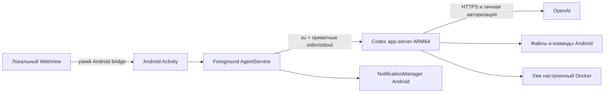

# Архитектура

## Интерфейс и движок

`MainActivity` открывает `WebChatActivity`. HTML/CSS/JS загружаются только из APK через локальный asset origin. Внешние сайты открываются отдельным Android intent в браузере и не получают доступ к `Phone` bridge. File/content access в WebView отключён; собственный обработчик выдаёт только ресурсы UI и проверенные media-идентификаторы.

`AgentService` запускает `/data/adb/avr-codex/run` через `su`. JSON-RPC Codex app-server идёт по stdin/stdout, без слушающего сетевого root API. Сессия авторизации хранится отдельно в приватном runtime. [Официальный протокол](https://learn.chatgpt.com/docs/app-server).

`EngineNetworkProxy` даёт статическому Linux-движку доступ к DNS и сети Android. Это HTTP/CONNECT listener только на loopback, со случайным портом и отдельным временным паролем на запуск. При новом соединении выбирается доступный HTTP-прокси Happ, иначе используются сокеты Android. Мост не расшифровывает TLS, не повторяет OAuth POST и не читает токены. Закрытие движка закрывает мост и его сокеты.

`LoginFlow` хранит только текущую попытку входа в памяти: создание ссылки, ожидание браузера и явная отмена. Повторное нажатие продолжает существующую попытку. Идентификаторы и поколения запросов защищают её от запоздалых результатов отменённого входа. Долговременные токены сохраняет и обновляет официальный app-server.

## Очередь и уточнения

`TurnOutbox` хранит текст, выбранную модель/effort, вложения и состояние доставки. Обычное сообщение ждёт завершения текущего turn. Уточнение использует `turn/steer` с `expectedTurnId`, не запускает новый turn и не меняет модель активного turn.

Остановка ставит оставшуюся очередь на паузу. После обрыва соединения или неоднозначной доставки сообщения не повторяются автоматически. Хранилище очереди не переносится между устройствами.

## Изображения и файлы

Системная галерея, clipboard, IME и Android Share передают URI выбранных изображений. `MediaFiles` декодирует изображение, ограничивает размеры и сохраняет частную копию; протокол получает `localImage` на телефоне либо inline image data при работе с ПК. Пользователь может отправить только изображения без текста.

События `imageGeneration` преобразуются в изображения в чате. Клиент принимает inline-результат или доступный локальный `savedPath`. Возможность генерации определяется движком/аккаунтом; клиент не содержит отдельного общего API-ключа. Результаты только с недоступным `fileId` без локального файла/inline-данных не загружаются автоматически.

По явному нажатию на локальный путь клиент читает файл и создаёт отдельную копию в Android cache. Неэкспортируемый `SharedFileProvider` выдаёт выбранному приложению доступ только по конкретному URI и только для чтения. Доступ к произвольной файловой системе через URI провайдера не предоставляется. Размер одной открываемой копии ограничен 50 МБ. Каталоги показываются встроенным простым списком.

## Уведомления

`TaskNotifications` использует Android `NotificationChannel`, `NotificationManager` и immutable `PendingIntent`. Фоновая работа видна через foreground-service; результат задачи публикуется в отдельном канале. На Android 13+ требуется разрешение на уведомления. На экране блокировки используется private visibility; в открытом приложении уведомления не должны издавать звук.

## SSH-прототип

`RemotePc` использует JSch. Приватный SSH-ключ шифруется ключом Android Keystore, host key компьютера закреплён; неизвестный сервер не принимается автоматически. SSH-профиль создаётся отдельно и не поставляется с исходниками/APK.

Подключение ожидает подготовленный серверный мост с фиксированной командой `avr-codex-pc`. В этой публикации нет автоматического установщика Windows OpenSSH и личного SSH-профиля. Состояние прототипа ограничено; без доступного адреса или личной VPN оно не обеспечивает соединение через интернет.
